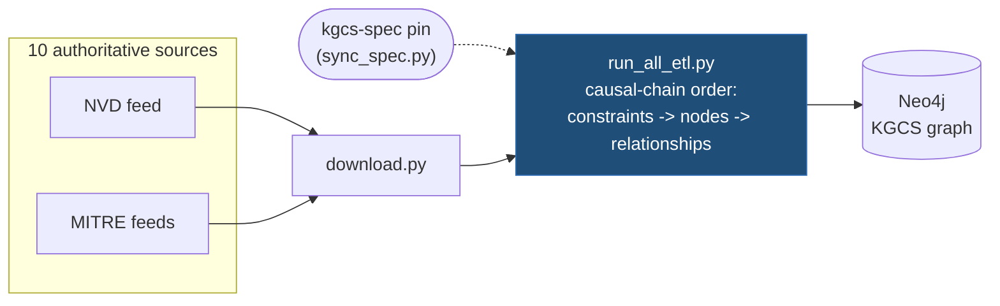

# kgcs-pipeline

Builds the KGCS Neo4j graph from the 10 authoritative sources (NVD and MITRE feeds), following the causal chain defined by [kgcs-spec](https://github.com/Ariadna-KGCS/kgcs-spec). Part of the [Ariadna-KGCS organization](https://github.com/Ariadna-KGCS).

## How it works



## Quickstart

```bash
git clone https://github.com/Ariadna-KGCS/kgcs-pipeline.git
cd kgcs-pipeline
pip install -r requirements.txt
python scripts/sync_spec.py                        # materialize the pinned kgcs-spec release
python scripts/download.py --standard all          # download raw datasets (~GBs)
cp .env.example .env                       # set NEO4J_URI / NEO4J_USER / NEO4J_PASSWORD
python scripts/run_all_etl.py                      # constraints → nodes → relationships
```

Requires Python 3.11+ and a running Neo4j instance (2026.05.x recommended; Community edition is fine here — this pipeline builds the graph fresh via ETL, it never loads the Enterprise-only Block-format dump. See [kgcs-server's install guide](https://github.com/Ariadna-KGCS/kgcs-server/blob/main/docs/mcp/install-guide.md) for why the version/edition matters).

## Layout

- `scripts/` — entrypoints `download.py`, `download_schemas.py`, `run_all_etl.py`, `sync_spec.py` (run from repo root; `data/raw` paths are CWD-relative)
- `downloaders/` — per-source download clients (NVD, MITRE) + universal downloader and validators
- `etl/` — constraint init + per-standard loaders, executed in causal-chain order
- `validation/` — SHACL/post-load validation + graph stats (`extract_neo4j_stats.py`)
- `utils/` — shared HTTP client (retries, backoff)
- `data/raw/` — downloaded datasets (gitignored; reproducible via `python scripts/download.py --standard all`)
- `data/schemas/` — JSON schemas of the *external* feeds (NVD/MITRE), used to validate raw data
- `spec/` — pinned `kgcs-spec` materialization (gitignored; see below)
- `config/` — optional downloader overrides (`download_config.yaml`, used only with `--config`)
- `tests/` — unit tests for transform logic (no Neo4j required; `pytest.ini` sets `pythonpath`)

## Spec Pin

`SPEC_VERSION` pins the `kgcs-spec` release this pipeline builds against (currently **1.2.1**). Materialize it with:

```bash
python scripts/sync_spec.py   # or: python scripts/sync_spec.py --url <kgcs-spec-url>
```

The script is idempotent: it wipes and rebuilds the gitignored `spec/` from the pinned tag (hand-edits cannot survive), records tag+commit in `spec/.pin`, and `--check` verifies the pin without syncing. CI runs it unconditionally before tests. SHACL/OWL validation reads from `spec/shapes/` and `spec/ontology/` by default.

## Rules

- Pins a released `kgcs-spec` version; graph shape must match its contracts.
- Load order: constraints → nodes → relationships, following the causal chain; no skipped hops.
- Outside the chain (spec 1.2): the decision leaves KEV / EPSS / SSVC load right after CVSS and hang only off `Vulnerability`; the ATLAS matrix loads right after ATT&CK and leaves ATLAS only through `ADAPTED_FROM`. Expected counts: `docs/spec-v1.2-deltas.md`.
- Parameterized Cypher + `MERGE` only; dedupe in Python before batch writes; stream large datasets.
- Verify external feed schemas from actual downloaded files before coding extraction logic.

## Validation

`python validation/validate_all_standards.py --post-load` checks the loaded graph
(details in `docs/pipeline-execution-guide.md`). A full load has exactly one
`BuildMetadata` node. `--partial-load` turns a missing one into a warning, for
development and `--step` loads only; more than one always fails. Q7 and any
pre-release validation run **without** `--partial-load`.

## Status

`devel` builds against `kgcs-spec` **1.2.1** (`sync_spec.py --check` green). Last full load validated 2026-09-28 on Neo4j `kgcs-v12`: 16 ETL steps (constraints, the chain, KEV/EPSS/SSVC decision leaves, ATLAS, build metadata; log 2026-09-28 00:41→01:59), post-load checks and expected deltas in `docs/spec-v1.2-deltas.md`. CI (`Test` workflow): `sync_spec.py` + `--check` + `pytest tests/` (109 passed, 2026-11-01). `main` still holds the 1.0.0-era pipeline until the 1.2.1 release PR lands. Pre-seed design notes live in `docs/historical/`.

## License

[Apache 2.0](LICENSE). The downloaded datasets (NVD, MITRE) remain subject to their own terms of use.
