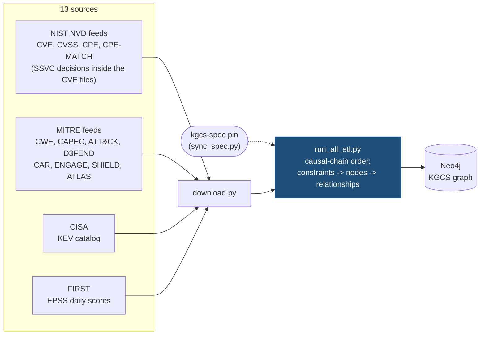

# kgcs-pipeline

Builds the KGCS Neo4j graph from 13 sources (the ten standards from the NIST NVD and MITRE feeds, plus the CISA KEV catalog, the FIRST EPSS scores and MITRE ATLAS; SSVC decisions are read from the NVD files), following the causal chain defined by [kgcs-spec](https://github.com/Ariadna-KGCS/kgcs-spec). Part of the [Ariadna-KGCS organization](https://github.com/Ariadna-KGCS).

## How it works



## Quickstart

```bash
git clone https://github.com/Ariadna-KGCS/kgcs-pipeline.git
cd kgcs-pipeline
pip install -r requirements.txt
python scripts/sync_spec.py                        # materialize the pinned kgcs-spec release
python scripts/download.py --standard all          # download raw datasets (~GBs)
cp .env.example .env                       # set NEO4J_URI / NEO4J_USER / NEO4J_PASSWORD
python scripts/run_all_etl.py                      # constraints → nodes → relationships
```

Requires Python 3.11+ and a running Neo4j instance (2026.05.x recommended; Community edition is fine here — this pipeline builds the graph fresh via ETL, it never loads the Enterprise-only Block-format dump. See [kgcs-server's install guide](https://github.com/Ariadna-KGCS/kgcs-server/blob/main/docs/mcp/install-guide.md) for why the version/edition matters).

## Layout

- `scripts/` — entrypoints `download.py`, `download_schemas.py`, `run_all_etl.py`, `sync_spec.py`, `build_run_report.py` (run from repo root; `data/raw` paths are CWD-relative)
- `downloaders/` — `universal_downloader.py` (what `download.py` runs: the 13 sources), the KEV, EPSS and ATLAS clients it calls, `ingest_config.py` (every URL), chunker and validators; the older per-source clients (`nist_nvd`, `mitre_*`) are not used by `download.py`
- `etl/` — constraint init, one loader per source and the build-metadata postscript, in the 16-step order of `run_all_etl.py`, plus shared helpers
- `validation/` — SHACL and post-load checks (`validate_all_standards.py`), offline expected counts (`expected_v12_deltas.py`, `expected_graph_deltas.py`), graph-quality gate (`check_graph_quality.py`), SHACL on exports (`shacl_export_check.py`, `shacl_export_v12.py`), graph stats (`extract_neo4j_stats.py`)
- `utils/` — shared HTTP client (retries, backoff)
- `data/raw/` — downloaded datasets (gitignored; reproducible via `python scripts/download.py --standard all`)
- `data/schemas/` — official schemas of the *external* feeds (NIST, MITRE, CISA), reference only: not read by the ETL or the validation (regenerated by `download_schemas.py`)
- `spec/` — pinned `kgcs-spec` materialization (gitignored; see below)
- `config/` — optional downloader overrides (`download_config.yaml`, used only with `--config`)
- `tests/` — unit tests for transform logic and the run-report generator (no Neo4j required; `pytest.ini` sets `pythonpath`)
- `docs/` — `pipeline-execution-guide.md` (every script), `fresh-load.md` and `fresh-load/` (rebuild procedure and one evidence directory per run), `analysis/`, `historical/`
- `SPEC_VERSION` — the pinned `kgcs-spec` release

## Spec Pin

`SPEC_VERSION` pins the `kgcs-spec` release this pipeline builds against (currently **1.2.1**). Materialize it with:

```bash
python scripts/sync_spec.py   # or: python scripts/sync_spec.py --url <kgcs-spec-url>
```

The script is idempotent: it wipes and rebuilds the gitignored `spec/` from the pinned tag (hand-edits cannot survive), records tag+commit in `spec/.pin`, and `--check` verifies the pin without syncing. CI runs it unconditionally before tests. SHACL/OWL validation reads from `spec/shapes/` and `spec/ontology/` by default.

## Rules

- Pins a released `kgcs-spec` version; graph shape must match its contracts.
- Load order: constraints → nodes → relationships, following the causal chain; no skipped hops.
- Outside the chain (spec 1.2): the decision leaves KEV / EPSS / SSVC load right after CVSS and hang only off `Vulnerability`; the ATLAS matrix loads right after ATT&CK and leaves ATLAS only through `ADAPTED_FROM`. Expected counts: `docs/spec-v1.2-deltas.md`.
- Parameterized Cypher + `MERGE` only; dedupe in Python before batch writes; stream large datasets.
- Verify external feed schemas from actual downloaded files before coding extraction logic.

## Validation

`python validation/validate_all_standards.py --post-load` checks the loaded graph
(details in `docs/pipeline-execution-guide.md`). A full load has exactly one
`BuildMetadata` node. `--partial-load` turns a missing one into a warning, for
development and `--step` loads only; more than one always fails. Q7 and any
pre-release validation run **without** `--partial-load`.

## Status

Release **v1.2.1** builds against `kgcs-spec` **1.2.1** (`sync_spec.py --check` green). Last full load validated 2026-11-27 on Neo4j `kgcs-2026-11-27`, from a fresh download (verdict GREEN: 16/16 ETL steps — constraints, the chain, KEV/EPSS/SSVC decision leaves, ATLAS, build metadata — 7,203,640 nodes reconciled, 34/35 post-load checks; the one red, `cwe_consequence_vocabulary`, flags CWE 5.0 values outside the spec 1.2.1 vocabulary; ETL in 72.5 min with the server memory sized as `docs/fresh-load.md` step 2 describes; details in `docs/fresh-load/runs/2026-11-27-kgcs-2026-11-27/README.md`). The same code first reproduced the 2026-11-01 build count for count from that build's inputs (`docs/fresh-load/runs/2026-11-27-kgcs-2026-11-rc/README.md`). Previous full loads: 2026-11-01 on `kgcs-2026-11`, 2026-09-28 on `kgcs-v12`; expected deltas in `docs/spec-v1.2-deltas.md`. CI (`Test` workflow): `sync_spec.py` + `--check` + `pytest tests/` (156 passed, 2026-11-27). Pre-seed design notes live in `docs/historical/`.

## License

[Apache 2.0](LICENSE) for the code. The data is not ours: the downloaded datasets, and any graph or dump built from them, remain subject to their owners' own terms of use: NIST (NVD: CVE, CVSS, CPE, CPE-MATCH), MITRE (CWE, CAPEC, ATT&CK, D3FEND, CAR, ENGAGE, SHIELD, ATLAS), CISA (KEV, SSVC decisions) and FIRST (EPSS). Sources, terms and the notices they ask for are in [`DATASET-NOTICE.md`](DATASET-NOTICE.md).
